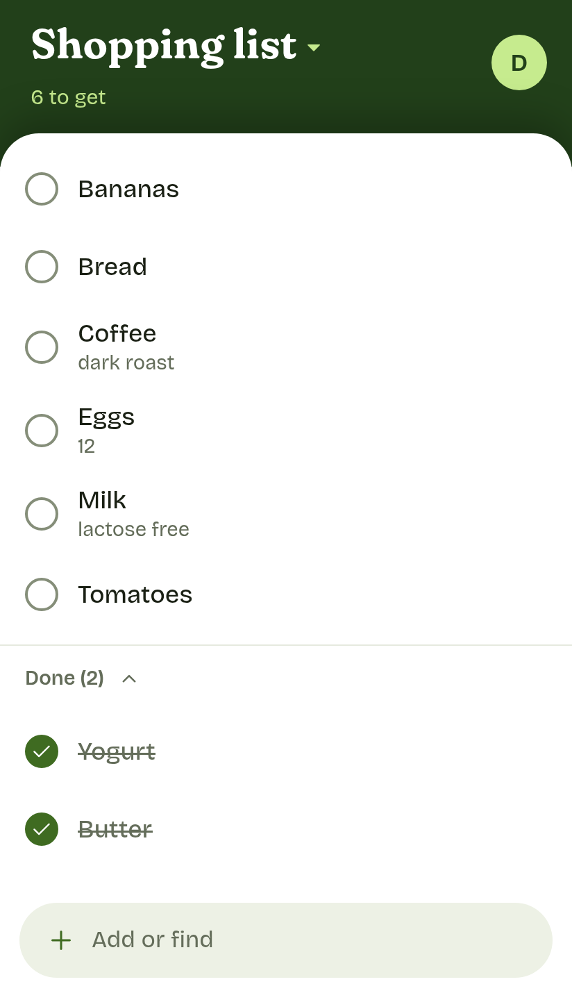

# Promus

A self-hosted grocery list for your phone that works offline. Anything you've bought before comes back with a tap, never as a duplicate, and checked items clear themselves instead of piling up.

In Latin, a *promus* is the household steward who brings provisions out of the storeroom.

<picture>
  <source media="(prefers-color-scheme: dark)" srcset="docs/images/list-dark.png">
  
</picture>

## Features

- Re-add anything you've bought before with a few letters and a tap, typos and diacritics included: "gradd" finds "grädd". The same item comes back, never a duplicate, with its usual quantity and price, and the list shows its total, what's left to buy, and who paid for what.
- With the add field empty, your most-bought items that aren't on the list are one tap away.
- Works fully offline in the store. Changes sync when the server is reachable, with nothing lost or duplicated.
- Checked items move to a Done section and leave the list after 24 hours.
- Every action can be undone from the snackbar. There are no confirmation dialogs.
- Share several lists and one item history with your household: invite each person with a link or a QR code to an account of their own. Friends without one can use a single list from a link, until it expires.
- Installs on Android and iPhone. Swedish and English, with light and dark themes.
- Runs on your own server, with no public sign-up: a friend can get lists of their own on it from an invite link. Every change is kept with when it happened and who made it.

## Status

Early: the list, search, offline sync, undo, the setup wizard and household invites are done, and being tried day to day. Sharing a list by link, prices, quantities and invites to lists of one's own are new.
Stats come next, then data export and a Home Assistant integration.

## Quick start

On a machine with Docker:

```sh
docker run -d --name promus -p 127.0.0.1:8080:8080 -v promus-data:/data --restart unless-stopped ghcr.io/aldinsmajlovic/promus
docker logs promus | grep 'Setup code'
```

Put HTTPS in front of `http://127.0.0.1:8080` with whatever you use to expose services: a reverse proxy, a tunnel or a VPN. The [self-hosting guide](docs/self-hosting.md#put-https-in-front) lists what Promus needs from it. Then open the `https://` address, enter the setup code, and follow the wizard. It ends with a QR code that opens Promus on your phone. Invite your household from **Settings** afterwards.

## Documentation

- [Self-hosting](docs/self-hosting.md): Docker, what HTTPS in front needs, the phone, invites, shared lists, backups and updates.
- [Promus with systemd](docs/proxmox.md): built from source and run as a systemd service, for example in a Proxmox LXC container.
- [Configuration](docs/configuration.md): the environment variables.
- [Server commands](docs/cli.md): accounts and backups.
- [Development](docs/development.md): running it locally, the checks, releasing and the project layout.
- [Decisions](docs/decisions.md): what changed from the original plan, and why.
- [Writing docs](docs/writing-docs.md): rules for these pages.

## License

[MIT](LICENSE).
