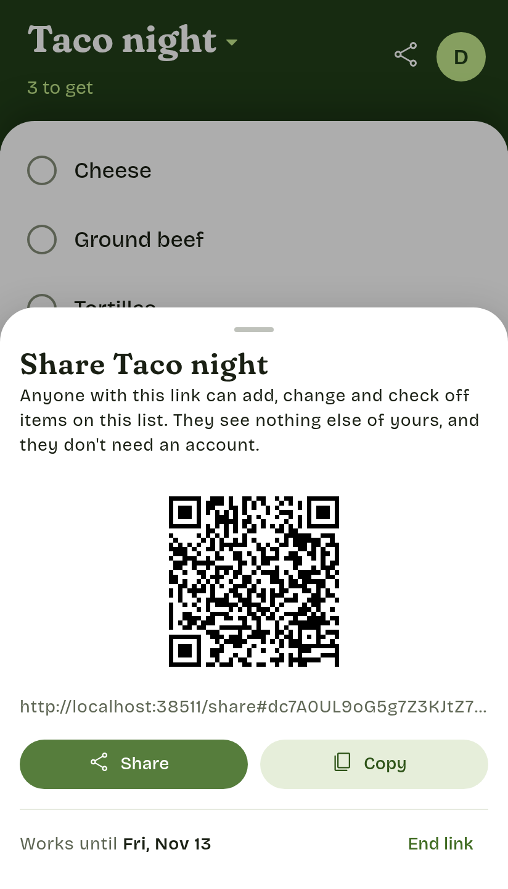
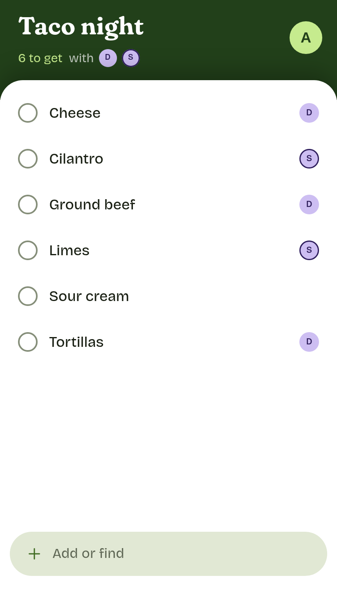

# Self-hosting Promus

Promus runs as one Docker container that serves the app and its API. How people reach it is up to you. Promus only needs HTTPS in front of it, because the app's service worker and its `Secure` session cookie only work in a secure context.

To run it as a systemd service instead, for example in a Proxmox LXC container, see [Promus with systemd](proxmox.md).

## Requirements

- An always-on machine with Docker, on amd64 or arm64: a home server, a NAS, a Raspberry Pi 4 or 5, or a small VPS. On Proxmox, run Docker in a VM, or use the [systemd setup](proxmox.md).
- Memory: the server uses about 60 MiB, plus 128 MiB for each sign-in in progress, which runs scrypt.
- A way to give it an `https://` address: a reverse proxy with a certificate, a tunnel, or whatever you already use.
- Phones: Android with Chrome, or an iPhone with Safari on iOS 17 or later.

## Start Promus

```sh
docker run -d --name promus -p 127.0.0.1:8080:8080 -v promus-data:/data --restart unless-stopped ghcr.io/aldinsmajlovic/promus
```

Or, with Compose, download [`compose.yaml`](../compose.yaml) into a folder of its own and run `docker compose up -d` there. Both name the container `promus`, which the commands below use.

- **Where it listens:** the server is reachable only from this machine, on `127.0.0.1:8080`. To use another port, change the left side of `-p` or `ports`.
- **Where the data lives:** the `promus-data` volume holds the database and its backups.
- **Configuration:** nothing needs setting. [Configuration](configuration.md) lists what can be set.

<!-- linked from the app: keep this heading -->
## Put HTTPS in front

Promus listens on plain HTTP. Exposing it, to your network or to the internet, is up to you: a reverse proxy with port forwarding, a tunnel, a VPN. Whatever you put in front must:
- serve it over HTTPS, with a certificate the phones trust;
- forward to Promus at `http://127.0.0.1:8080`;
- keep the original `Host` header. The server compares a request's `Origin` with its `Host` to block cross-site requests.

Forwarding port 8080 itself doesn't work. That's plain HTTP: browsers won't keep the sign-in, and passwords would cross the network unencrypted.

For example, [Caddy](https://caddyserver.com) gets a certificate on its own and keeps the `Host` header. With port 443 forwarded to it, this is the whole configuration:

```
promus.example.com {
	reverse_proxy 127.0.0.1:8080
}
```

If the proxy runs on another machine, publish the port where it can reach it, for example `-p 192.168.1.10:8080:8080`, and keep that address off the internet.

When Promus is reachable from the internet:
- **Anyone can open the sign-in page.** There's no sign-up, and the first account needs the setup code from the server's log.
- **Choose strong passwords.** Promus allows 10 failed sign-ins per username every 15 minutes.

## Set up your account

Open the server's `https://` address. A new server shows the setup wizard:
1. Pick Swedish or English. It also names your first list.
2. Enter the setup code, then choose a username and a password of at least 8 characters.
3. Get it onto your phone, as described below.

The setup code is in the server's log:

```sh
docker logs promus | grep 'Setup code'
```

It prints a line with `Setup code: XXXX-XXXX`. Case and the dash don't matter. A restart prints a new code, and once the first account exists, no code works any more.

## Install the app on your phone

The wizard's last step, and **Settings > Install app**, show the server's address as a QR code. Scan it with the phone's camera.

- **Android:** in Chrome, tap **Install app** in Promus, or choose **Install app** from Chrome's menu.
- **iPhone:** in Safari, tap **Share**, then **Add to Home Screen**. Open Promus from the Home Screen and sign in once more: the installed app keeps its own sign-in, apart from Safari's. Install it before relying on it. Safari may clear a website's data after 7 days without use, and changes that haven't synced yet would go with it. An app on the Home Screen counts only its own days of use.

The installed app works offline and syncs whenever the phone can reach the server.

## Invite your household

In **Settings**, open **Household** and tap **Invite someone**. The link shows as a QR code to scan, with **Share** and **Copy**.
- **The link:** it works once, for 7 days. **Undo** in the snackbar cancels it.
- **Joining:** whoever opens it chooses their own username and password, joins your household, and sees the same lists and item history.
- **Removing:** only the household's owner can remove someone. Hold a member's row, or right-click it, and choose **Remove from household**. **Undo** in the snackbar puts them back, unless they have already started lists of their own. They keep their account and get lists of their own; their phones delete your household's data at the next sync, even changes not yet synced. Their name stays on what they added. Share links already made keep working: end the link and share the list again to cut one off.
- **Leaving:** a member taps **Leave household** at the bottom of the page, once their changes have synced. **Undo** keeps them in; otherwise they start over with lists of their own.

## Invite a friend

For a friend who wants Promus but not your lists: in **Settings**, tap **Invite a friend**. The link shows as for an invite, works once, for 7 days, and **Undo** in the snackbar cancels it.
- **Joining:** whoever opens it chooses a username and password and gets an account on your server with a list of their own, named in the language they chose. It works offline and syncs as yours does.
- **Who sees what:** they don't see your lists and you don't see theirs, in the app. Their lists are in your database and your backups, as everyone's are.
- **A forgotten password:** `user:password` from the [server commands](cli.md) sets a new one.

## Share a list

To let friends without an account use one list, tap **Share** in the band, beside your initial, and choose **Share link**. The link shows as a QR code, with **Share** and **Copy**. Whoever opens it types a name, or leaves it empty to show as Guest, and is on the list. On that phone, the link opens the list straight away after that.

<picture>
  <source media="(prefers-color-scheme: dark)" srcset="images/share-sheet-dark.png">
  
</picture>
<picture>
  <source media="(prefers-color-scheme: dark)" srcset="images/guest-list-dark.png">
  
</picture>

- **What guests can do:** on that list only, what you can: add items, check them off, remove them, rename them, write notes and set quantities and prices, with Undo, offline too. A rename or a price shows on your other lists too, as yours does. They don't see your other lists, items that haven't been on this list since the link was made, the list's history from before it, or Settings.
- **Your suggestions:** guests can't remove anything from them. A guest who types the name of an item you removed puts it on the list, but not back in your suggestions, if the item has been on this list since the link was made: their phone knows only those. Any other name they type is a new item, and it stays in your suggestions, also after their Undo, until someone in the household removes it.
- **The link:** it works for 14 days. A list has one live link: sharing it again shows the same one, and anyone in the household can end it. The list menu marks shared lists with a link icon.
- **Ending it:** **End link**, under the link, ends it at once, and **Undo** in the snackbar brings it back within its 14 days. Guests see that the link has ended the next time their phone reaches the server. What they added stays on the list, with their names, but changes made offline that never reached the server are lost. A guest whose phone reaches the server before the Undo sees the same, and gets the list back, as the same guest, by opening the link again. Deleting the list ends its link too, until the delete is undone.
- **A leaked link:** anyone who has it can change that one list until the link ends, and sees nothing else. A link takes at most 50 guests.
- **As text:** **Copy as text** and **Copy as Markdown**, in the same menu, copy what's left to get under the list's name, to paste anywhere. Markdown makes it a checklist. Guests have these two as well.
- **Reaching the server:** friends open the link on their own phones, so the server must be reachable from the internet. Over a VPN or only on your home network, you can share only with people on it.
- **Chat apps:** some open links in a browser of their own. There the list works while it's open, but reopening it may need signal. Opening the link later in another browser makes a second guest.

## Backups and restore

Back up every night from cron or a systemd timer on the host, and copy the backups somewhere else:

```sh
docker exec promus node apps/server/src/cli.ts backup
docker cp promus:/data/backups ./backups
```

- **What a backup is:** a complete, consistent copy of the database, written to `/data/backups/promus-YYYY-MM-DD.db` and named by the UTC date. The 14 newest are kept.
- **Where it lives:** in the `promus-data` volume, so `docker volume rm promus-data` deletes the backups along with the database. Keep copies outside the volume.
- **Never copy the live `promus.db` on its own.** Recent changes live in `promus.db-wal` until SQLite folds them in.

To restore a backup:

```sh
docker stop promus
docker run --rm -v promus-data:/data ghcr.io/aldinsmajlovic/promus sh -c 'cp /data/backups/promus-YYYY-MM-DD.db /data/promus.db && rm -f /data/promus.db-wal /data/promus.db-shm'
docker start promus
```

Removing the `-wal` and `-shm` files matters: they belong to the old database, and SQLite would apply them to the restored one.

**A restore loses every change made after the backup.** That covers list changes, and also accounts, passwords, invites, sessions, shared links and their guests, which all return to their state in the backup.

**Then reset every device.** Each device remembers how far it has synced by its position in the server's log. A restored server hands out those positions again.
- A device that had synced past the backup would never receive new changes.
- Its own changes from after the backup would stay on that device only.

On every device:
1. Open **Settings**, tap your name, and sign out, then sign back in. Signing out clears the device's local copy. It refuses while the device has unsynced changes, so let it sync first.
2. If the app already shows the sign-in page, don't delete its site data: the device may still hold changes it hasn't synced. Instead:
   1. Sign in again as the **same** user. That keeps the local copy and its unsynced changes.
   2. Let it sync, until the badge on your initial is gone.
   3. Open **Settings**, tap your name, sign out, and sign in again.
3. If signing in says the changes are from **another account** with that name, the server no longer has the account they were made by: it was created after the backup, or the device last synced with another server. Those changes can't sync anywhere. Delete the site's data in the browser, then sign in.

**Then end every live link and share it again.** Ending deletes what guests' phones keep of the list. A guest whose phone had synced past the backup would otherwise miss new changes without a word.

## Updating

Back up first: database migrations run on startup and are forward-only.

```sh
docker exec promus node apps/server/src/cli.ts backup
docker pull ghcr.io/aldinsmajlovic/promus
docker rm -f promus
docker run -d --name promus -p 127.0.0.1:8080:8080 -v promus-data:/data --restart unless-stopped ghcr.io/aldinsmajlovic/promus
```

With Compose, the last three lines are `docker compose pull && docker compose up -d`.

Installed apps pick up the new version on their own and offer a reload.

**Settings** says when a new version is out, with what changed since yours. To know, the server asks GitHub for Promus's releases, at most once a day and only when someone opens Settings. A server that can't reach GitHub shows nothing.
